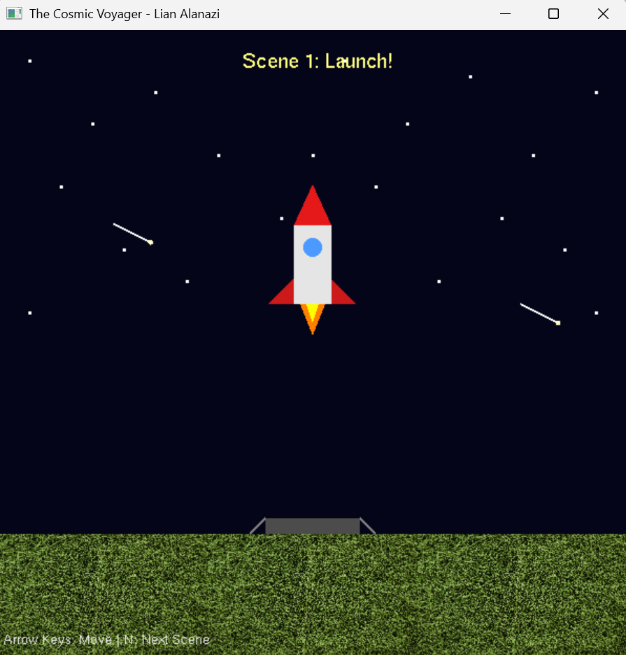
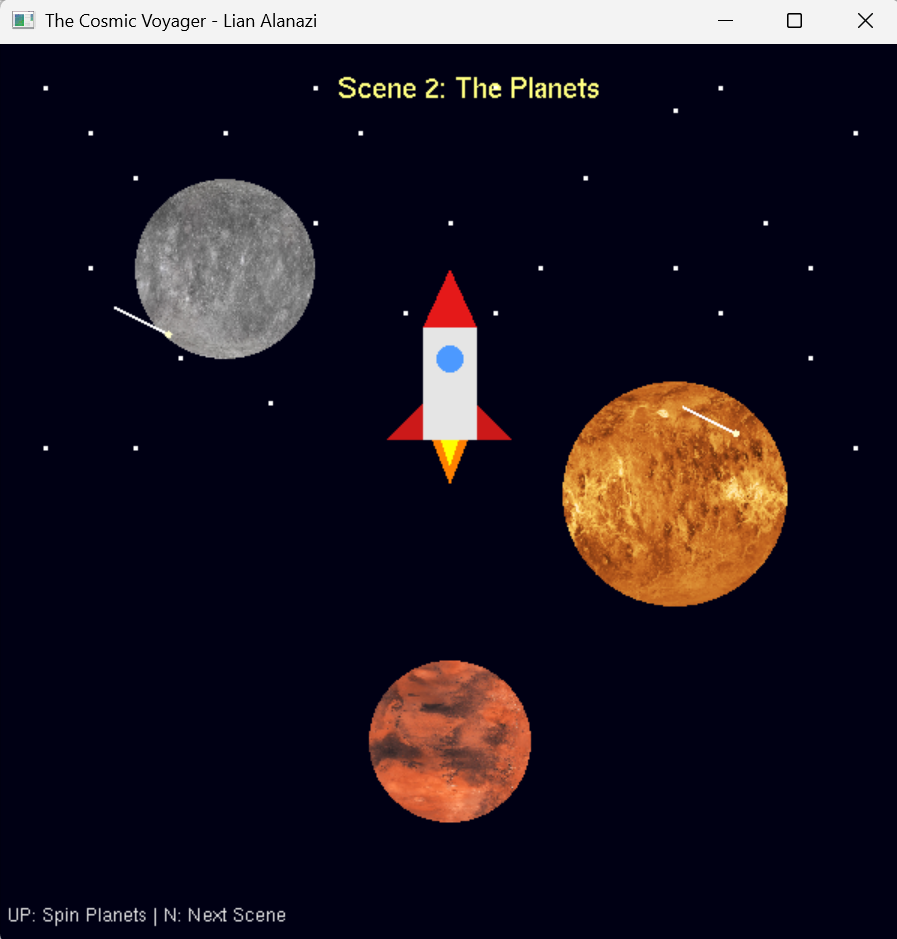
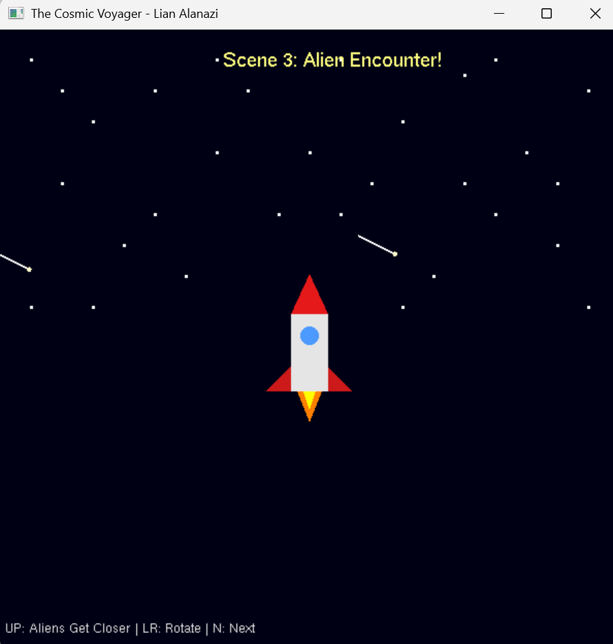
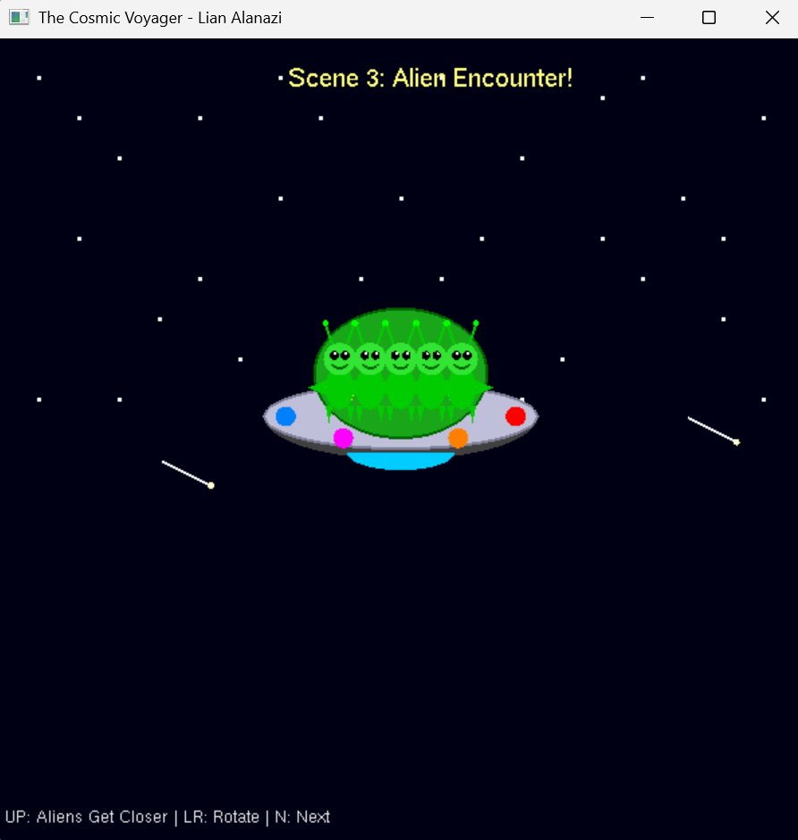
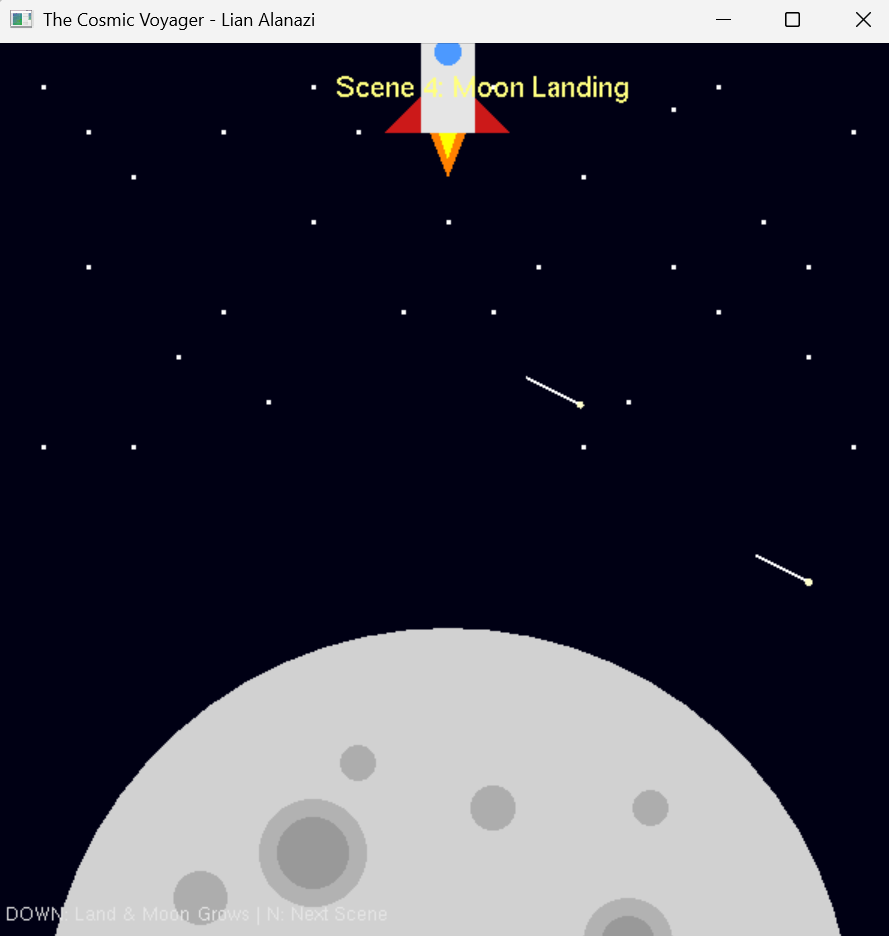
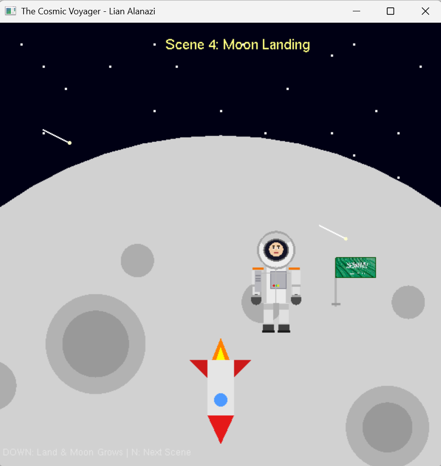
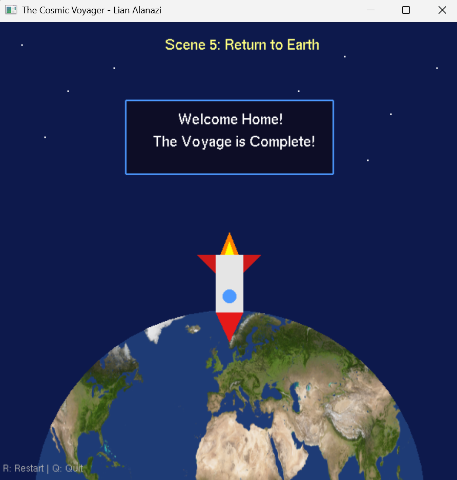

[README.md](https://github.com/user-attachments/files/33552419/README.md)


# The Cosmic Voyager

An interactive 2D space-mission animation built in **C++ with OpenGL and GLUT**. The program tells a five-scene story — launch from Earth, a flight past rotating planets, an alien encounter, a landing on the Moon where an astronaut plants the Saudi flag, and the return home — with the rocket controlled from the keyboard the whole way through.

Built for **CS2206 – Computer Graphics** at Umm Al-Qura University, 2025–2026.

## My role

I built this project end to end, every scene, the full code and its integration into one working program, and the complete project report, presentation and demo video. The work included:

- **Scene 1 – Launch from Earth:** the night sky and star field, the grass-textured ground, the launch pad, the full rocket model, and the shooting-star animation.
- **Scene 2 – Orbiting Planets:** Mercury, Venus and Mars as texture-mapped circles, each rotating at its own speed and direction.
- **Scene 3 – Alien Encounter:** the alien spacecraft — dome, aliens inside, rim lights, metallic rim and exhaust glow — and its descent, synced against the rocket's climb.
- **Scene 4 – Moon Landing:** the Moon with its scaling approach effect, the 180° landing flip, and the detailed astronaut who plants the Saudi flag.
- **Scene 5 – Return to Earth:** the texture-mapped Earth, the landing sequence, and the "Welcome Home" message box.

Plus the code integration — the scene-based structure, the shared state across scenes, and the build that compiles and runs end to end.


## How it works

The program runs on a scene-based structure. A single `currentScene` variable drives a `switch` in the display function that calls the right scene, which keeps the five scenes cleanly separated and makes the whole thing run as one continuous experience rather than five separate programs.

```cpp
switch (currentScene) {
    case 1: drawScene1(); break;
    case 2: drawScene2(); break;
    case 3: drawScene3(); break;
    case 4: drawScene4(); break;
    case 5: drawScene5(); break;
}
```

Reusable drawing helpers (`drawCircle`, `drawRect`, `drawText`) are shared across every scene. Since OpenGL has no built-in circle, circles are approximated with a `GL_TRIANGLE_FAN` of 60 triangles.

**Texture mapping** uses a custom `LoadTexture()` function that opens a BMP file, reads the pixel-data offset and bit depth from the BMP header, supports 24- and 32-bit images, converts the colour order from BGR to RGB, and uploads the result with `glTexImage2D`.

**Transformations** use the OpenGL matrix stack — `glPushMatrix` / `glPopMatrix` isolate each object's translation, rotation and scaling. Animation is driven by a timer firing roughly every 16 ms (~60 FPS), which also moves the shooting stars across scenes 1–4.

## The five scenes

### Scene 1 — Launch from Earth
A dark night sky with a star field (`GL_POINTS`), a grass-textured ground drawn with `GL_QUADS` and `GL_REPEAT`, and a launch pad with legs in `GL_LINES`. The rocket is assembled from primitives: a `GL_QUADS` body, `GL_TRIANGLES` nose and fins, a `GL_TRIANGLE_FAN` cockpit window, and layered triangles for the flame. Arrow keys move the rocket (translation); shooting stars cross the sky automatically.



### Scene 2 — Orbiting Planets
The rocket flies past Mercury, Venus and Mars, each a texture-mapped circle. The planets rotate at different rates — Mercury at full speed, Venus in the opposite direction, Mars at half speed.



### Scene 3 — Alien Encounter
An alien spacecraft descends as the rocket climbs: a green dome holding five aliens, six coloured rim lights, a silver rim and a blue exhaust glow. The ship closes in using scaling and translation, moving slower than the rocket to stay on screen longer, and the rocket tilts with `glRotatef` when you steer left or right.




### Scene 4 — Moon Landing
The Moon sits below the view and grows via `glScalef` as you descend. The rocket flips a full 180° with `glRotatef` to orient for landing, and on touchdown an astronaut appears and plants the Saudi flag (a texture-mapped rectangle).




### Scene 5 — Return to Earth
The rocket comes home to a texture-mapped Earth, and a "Welcome Home — The Voyage is Complete!" message box appears on landing, with the option to restart or quit.



## Controls

| Key | Action |
|-----|--------|
| Arrow keys | Move the rocket (behaviour changes per scene) |
| N | Next scene |
| R | Restart from Scene 1 |
| Q / Esc | Quit |

## Building and running

Needs **OpenGL, GLUT/FreeGLUT and GLEW**. Textures load from a `textures/` folder next to the project (`mercury.bmp`, `mars.bmp`, `venus.bmp`, `Earth.bmp`, `grass.bmp`, `SaudiFlag.bmp`).

**Windows (Visual Studio)** — open `Project.vcxproj`, let NuGet restore the `nupengl.core` package (it bundles FreeGLUT and GLEW), then build and run with **F5**. Keep the `textures/` folder next to the `.vcxproj` so the relative paths resolve.

**g++ (Linux):**
```
g++ Project.cpp -o cosmic_voyager -lglut -lGLEW -lGL
```

## Concepts demonstrated

Translation, rotation and scaling · 2D orthographic projection (`glOrtho`) · texture mapping with a hand-written BMP loader · primitive-based modelling · keyboard interaction via GLUT callbacks · timer-driven animation.

## Author

**Lian Talal Alanazi** — Computer Science, Umm Al-Qura University.
